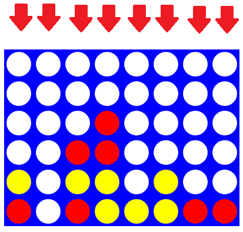

#哎我操怎README也一起复制过来了，算了一起弄个存档吧
- 下面是题目，还有我们学校的雷霆大logo
- 作业写不完完完完完完完完……完啦~
- 下次demo的试玩能不能给个雷霆大标题放在开头啊啊啊啊，下面看了几遍愣是没看懂
- 玩了几把demo就懂了
- 等一下……玩完这一把就去写代码，再玩一把……


# COMP2056 Programming Assignment 1 - Connect4

## 2026-27 Semester 1

* Designed by: [Dr. Kevin Wang](mailto:kevinw@comp.hkbu.edu.hk)
* Q & A: [Discord](https://discordapp.com/channels/1004554070083776672/1004554070083776678)
* Assignment Website: [GitHub](https://github.com/khwang0/COMP2056-2627PA1)
* Due:
  * UAT due: 23:59 on 3 October 2026 (Saturday midnight)
  * Programming due: 23:59 on 10 October 2026 (Saturday midnight)
* Download the starter code: [Connect4.java](Connect4.java)
* Download the demo program: [here](demo.jar)
* Download everything from the assignment: [here](https://github.com/khwang0/COMP2056-2627PA1/archive/refs/heads/master.zip)

> To run the demo program, type the following in your terminal:
> 
> ```sh
> java -jar demo.jar
> ```


# Learning Outcomes

Students are expected to gain some practice with arrays, 2D arrays, parameter passing, and method construction and usage in this assignment. We expect most students to spend twelve hours or more completing the assignment without any assistance, or six hours or more without completing the `checkMate` method. Make sure you start as early as possible, and ask us on Discord if you have any difficulty! Note: We want to familiarize you with arrays and 2D arrays, so you are not supposed to use advanced data structures such as `ArrayList`, `Set`, or `Map`.


# Introduction

You are going to complete the Connect4 program! Open [Connect4.java](Connect4.java) and complete the methods stated in the skeleton code. Some of these methods are very straightforward, while some of them are not that easy. Make sure you follow the instructions given at the top of each method.

A [sample program](demo.jar) is provided. When there is something you are not sure about, you can look at the sample program to decide what to do.

Some methods are labeled as completed or given. Please do not make any changes to those methods. You are not supposed to modify them. **You can add your own method if you want to.**

# Explanation of the Game Connect4



<sub><sup>image ref: https://roadtolarissa.com/connect-4-ai-how-it-works/</sup></sub>

You can skip this section if you have experience playing the game Connect4! It is a 6x8 grid where players take turns dropping their blocks into one of the columns. Their blocks will reach the bottom by gravity. The first player to create a line of four consecutive blocks bearing their symbol wins. The game ends with "Player 2" winning if all the holes are filled.


# Explanation of the Assignment

You are given the skeleton code [Connect4.java](Connect4.java). Complete all methods in the assignment according to the instructions stated in the Java file. A JUnit file, [TestClass.java](TestClass.java), is provided. You can run the JUnit file to test your code.


# Understanding the Assignment Test (UAT)

This part is independent of your programming code. You will need to answer the following short questions by **a separate due date**. You should determine the answers from the skeleton code and the demo program. You should also test your code to ensure that it works as expected. Submit your answers on Moodle.

1. Which method is responsible for printing the game board?
2. Which method is responsible for deciding whether the game ends?
3. Will a player lose his/her turn if he/she decides to change his/her symbol?
4. Can a player change his/her symbol after he/she has played for one or two turns?
5. Write down the function of each keyboard input in the game. For example, `'0'` to `'7'` are used to drop a block into the corresponding column.


---


# Submission
For submission, upload the file `Connect4.java` to the designated submission box online.


## Plagiarism

Plagiarism is a serious offense and can be easily detected. Please do not share your code with your classmates, even if they threaten you with their friendship. If they do not have the ability to work on something that can compile, they will not be able to change your code into a state in which we cannot detect the act of plagiarism. For the first plagiarism offense, regardless of whether you shared your code or copied code from others, you will receive 0, along with an additional 5-mark penalty. If you commit plagiarism twice, your case will be presented to the examination board, and you will receive an F directly.

## Marking Scheme

The assignment will be graded automatically using JUnit.

* 5%: Understanding the Assignment Test (UAT)
* 15%: The program can be compiled using JDK 11
  * Less than 5% if the program can be compiled using a different version of the JDK.
* 80%: The program can pass all the test cases in the JUnit file.
* -30%: If any part of the skeleton code is modified, including changing a method signature, adding a new data member (adding global variables), or modifying a part that is not allowed to be changed according to the marking scheme.
* -30%: If any advanced data structure is used, including `ArrayList`, `Set`, or `Map`.
* -100%: For violating the plagiarism or AI policy.


## Interview
If the teaching team deems it necessary, students may be requested to attend an interview to explain their program. Students who fail to attend such an interview or demonstrate a good understanding of their own program may receive a mark deduction.


